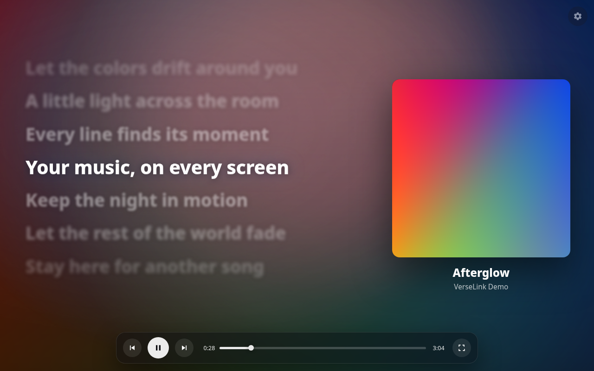
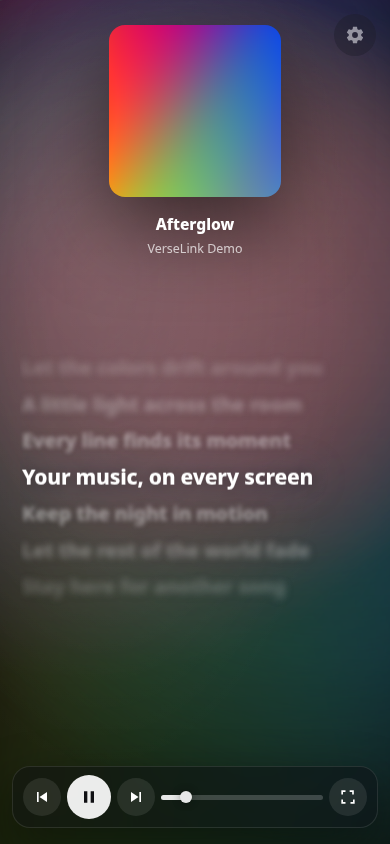

<div align="center">

# VerseLink

**Your music. Your lyrics. Any screen.**

A self-hosted, fullscreen lyrics display and media remote with flowing album-art backgrounds.

[](LICENSE)
[](https://www.python.org/downloads/)
[](#quick-start)
[](https://github.com/SaifDemos/verselink/actions/workflows/checks.yml)

[Quick start](#quick-start) · [Features](#features) · [Contributing](CONTRIBUTING.md) · [Report a bug](https://github.com/SaifDemos/verselink/issues/new/choose)

</div>



VerseLink follows the music already playing on your computer, finds timed lyrics,
and turns any browser into a lyrics screen. Open it on your desktop, phone, or
tablet to follow along and control playback. **Your player keeps playing; VerseLink
does not stream or capture audio.**

## Features

- **Lyrics that stay in time** — line-by-line highlighting, local `.lrc` files,
  and online lookup through [LRCLIB](https://lrclib.net).
- **Liquid album-art backgrounds** — blurred artwork flows and blends into a
  Spotify-inspired backdrop, with a color wash when artwork is unavailable.
- **Your actual media apps** — choose from open players such as Spotify, VLC,
  Strawberry, mpv, and browsers, when they expose system media controls.
- **A remote on any screen** — play/pause, previous/next, seeking, fullscreen,
  keyboard shortcuts, and touch gestures over your local network.
- **Make it yours** — five layouts, text and cover sizing, animation speeds,
  static backgrounds, and an optional clock. Appearance is saved per device.
- **Offline replay** — previously fetched lyrics are cached; local sidecar
  lyrics do not need an internet connection.
- **Small by design** — Python's standard library, an embedded web UI, and no
  `pip install`, frontend build step, accounts, or audio permissions.

<details>
<summary>Phone preview</summary>

<p align="center">
  
</p>

</details>

*Screenshots use original demo artwork and placeholder lyrics, not commercial media.*

## Quick start

You need **Python 3.8+**, a modern browser, and a media app that exposes system
media controls. Use a currently supported Python version when possible.

Clone the project, or [download the ZIP](https://github.com/SaifDemos/verselink/archive/refs/heads/main.zip)
and extract it:

```sh
git clone https://github.com/SaifDemos/verselink.git
cd verselink
```

> [!WARNING]
> VerseLink has no authentication and listens on your network by default. Run it
> only on a trusted LAN. Do not expose its port to the internet. For desktop-only
> use, bind to `127.0.0.1` as shown below.

### Linux

Install [`playerctl`](https://github.com/altdesktop/playerctl) with your distro's
package manager. For Debian/Ubuntu:

```sh
sudo apt install playerctl
```

Start your music, then launch VerseLink in the background:

```sh
./start.sh
```

### Windows

Requires **Windows 10 1809+ or Windows 11** and the built-in **PowerShell 5.1**.
The backend uses Windows Global System Media Transport Controls (GSMTC).

In PowerShell, from the project folder:

```powershell
.\start.ps1
```

If script execution is blocked, use a process-scoped bypass after reviewing the script:

```powershell
powershell -NoProfile -ExecutionPolicy Bypass -File .\start.ps1
```

For access from another device, allow Python through Windows Firewall on
**private networks only**.

### Open your lyrics screen

The launcher prints both the local and LAN URLs. Open
**http://127.0.0.1:8765** on the computer, or the printed **network URL** on a
phone/tablet connected to the same LAN. No app installation is needed on the
second device.

To stop the background service, use `./stop.sh` on Linux or `.\stop.ps1` in
PowerShell. Logs and the process ID are stored in `.run/`.

## Configuration

The launchers accept these options:

| Setting | Linux environment variable | Windows parameter | Default |
| --- | --- | --- | --- |
| Bind address | `HOST` | `-Bind` | `0.0.0.0` (LAN access) |
| HTTP port | `PORT` | `-Port` | `8765` |
| Initial media source | `PLAYER` | `-Player` | Automatic |

For local-only access on a different port:

```sh
HOST=127.0.0.1 PORT=9000 ./start.sh
```

```powershell
.\start.ps1 -Bind 127.0.0.1 -Port 9000
```

Stop an existing background instance before changing launcher options. For
foreground use or debugging, run the Python server directly:

```sh
python3 verselink.py --host 127.0.0.1 --port 9000
python3 verselink.py --player spotify
```

Use `python` or `py -3` instead of `python3` on Windows; press `Ctrl+C` to stop.

## Controls & appearance

Open **Settings** in the top-right corner, or press `S`.

- **Audio source:** select an open media app, or use Automatic. The selection is
  shared by the server; if a selected app closes, VerseLink falls back to Automatic.
- **Background:** Liquid is the default. Subtle, Normal, and Cinematic control its
  speed; Off freezes it. Reduced-motion preferences and hidden tabs pause motion.
  Blur, Colors, and Dark are static alternatives.
- **Layout:** put lyrics on either side of the cover, stack them, show lyrics only,
  or use full-cover mode. Appearance settings stay in that browser's local storage.

| Key | Action |
| --- | --- |
| `Space` | Play/pause |
| `←` / `→` | Previous / next track |
| `S` | Open/close settings |
| `F` | Toggle fullscreen |
| `Esc` | Close settings |

Move the pointer or tap to reveal controls. On touch screens, swipe **right** on
the lyrics for the next track and **left** for the previous one. Click a lyric
line while controls are visible to seek to it.

## How lyrics work

1. **Local first:** when the player supplies a `file://` track URL, VerseLink
   looks for a matching `.lrc` or `.LRC` beside the audio file:

   ```text
   Music/track.flac
   Music/track.lrc
   ```

2. **Cache next:** previously fetched lyrics are reused from disk.
3. **Online fallback:** LRCLIB is queried by title, artist, album, and duration;
   a title/artist search is tried if no exact synced match is found.

Downloaded lyrics live in `~/.cache/verselink/`; an existing older
`~/.cache/synclyrics/` directory is reused for compatibility. Artwork is cached
in its `art/` subdirectory. Offline playback works for local lyrics and songs
whose lyrics were fetched before—not arbitrary new songs.

Lyrics are **line-synced**, not word-synced. Availability and timing depend on
your player metadata and the lyric source. Windows GSMTC does not expose local
file paths, so local sidecar lookup is not available through that backend.

## Troubleshooting

| Problem | What to check |
| --- | --- |
| Nothing playing / no sources | Start playback in an app with system media controls. On Linux, check `playerctl -l`. Refresh Audio source in Settings. |
| Phone cannot connect | Use the printed LAN URL, not `127.0.0.1`. Check the firewall, Wi-Fi client isolation, and bind address. |
| No synced lyrics | Verify title/artist metadata, try a matching local `.lrc`, or check LRCLIB. Uncached songs need internet access. |
| Background is not moving | Choose Liquid and a non-Off animation. Check your device's reduced-motion setting. |
| Address already in use | Stop the previous instance, or choose a different port. Check `.run/` logs. |

Linux playback and browser behavior have been exercised. The Windows backend is
included, but real-device GSMTC validation is still needed; testing help is welcome.
macOS is not currently supported.

## Privacy & security

There are no accounts or analytics. First-time online lyric lookups send song
metadata to LRCLIB; remote artwork is fetched from the URL supplied by your player.
Lyrics/artwork caches remain on the computer running VerseLink. Browser appearance
preferences remain on each device.

Anyone who can reach the server can control playback. The custom POST header
blocks ordinary cross-origin browser control, but **is not authentication**.
Use a trusted network, bind locally when appropriate, and see [SECURITY.md](SECURITY.md)
for the security model and private vulnerability reporting.

## Contributing

Bug reports, player compatibility reports, documentation improvements, and pull
requests are welcome. Start with [CONTRIBUTING.md](CONTRIBUTING.md).

The project deliberately stays simple:

| Path | Purpose |
| --- | --- |
| `verselink.py` | HTTP server, media integration, lyrics/art cache, embedded HTML/CSS/JS |
| `win-gsmtc.ps1` | Windows GSMTC bridge |
| `start.sh` / `stop.sh` | Linux background launcher and stopper |
| `start.ps1` / `stop.ps1` | Windows background launcher and stopper |
| `.github/workflows/checks.yml` | Python, embedded JavaScript, shell, and PowerShell syntax checks |

## License & credits

VerseLink's code and project-owned assets are available under the [MIT License](LICENSE).
Lyrics and album artwork belong to their respective rights holders; the license
does not grant rights to third-party media.

Thanks to [LRCLIB](https://lrclib.net) for lyrics,
[`playerctl`](https://github.com/altdesktop/playerctl) for Linux media integration,
and [Windows GSMTC](https://learn.microsoft.com/en-us/uwp/api/windows.media.control.globalsystemmediatransportcontrolssessionmanager)
for Windows media controls. VerseLink is an independent project and is not
affiliated with Spotify or these services.
